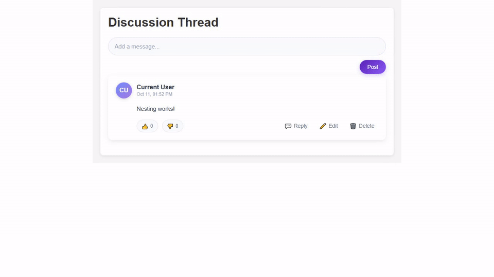
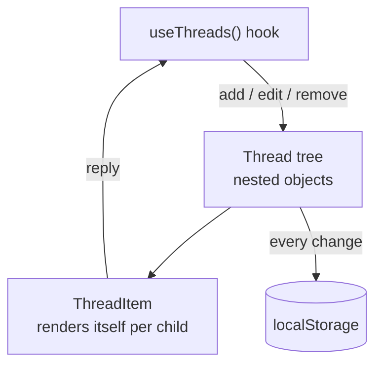

<h1 align="center">Nested Comments Thread</h1>

<p align="center"><b>A recursive comment system where replies nest to any depth — add, edit, reply and delete, with the whole thread persisted to localStorage.</b></p>

<p align="center">
[](https://nested-comment-systemm.netlify.app/)


</p>

<p align="center">[**Live demo**](https://nested-comment-systemm.netlify.app/) · [Quick start](#quick-start) · [Features](#features) · [Architecture](#architecture) · [FAQ](#faq)</p>

<p align="center">
  <a href="https://nested-comment-systemm.netlify.app/">
    
  </a>
</p>

<p align="center"><sub>Live capture of the real build — 571 KB, loops forever.</sub></p>

## Overview

A comment thread is a tree, not a list, and that is the interesting part of this project. Every reply can itself be replied to, so the UI is a recursive component that renders itself for each child, and the state logic has to insert, update and delete nodes at an arbitrary depth without flattening the structure.

All of that logic lives in one custom hook, `useThreads`, which exposes `addThreadItem`, `editThreadItem` and `removeThreadItem`. It persists the tree to `localStorage` on every change, so a reload keeps the conversation.

## At a glance

| Field | Detail |
| --- | --- |
| **Type** | Web application — Vite build |
| **Primary language** | JavaScript |
| **Live demo** | [nested-comment-systemm.netlify.app](https://nested-comment-systemm.netlify.app/) |
| **Repository** | [Mister2314/Nested-Comments-Thread](https://github.com/Mister2314/Nested-Comments-Thread) |

## Features

- Replies nest to unlimited depth, rendered by a self-recursive `ThreadItem` component
- Add a root comment or reply to any node
- Inline editing with an `edited` flag on the item
- Delete any node, root or nested
- Like / dislike counters per comment
- Initials avatar, author name and relative timestamp per item
- Whole tree persisted to `localStorage` through the `useThreads` hook
- Component-scoped styling with CSS Modules

## Tech Stack

| Layer | Technology |
| --- | --- |
| UI | React 19 |
| State | Custom `useThreads` hook + `localStorage` |
| Styling | CSS Modules |
| Build | Vite, ESLint |

## Architecture



## Screenshots

| Desktop | Mobile |
| :---: | :---: |
|  |  |

## Quick Start

```bash
git clone https://github.com/Mister2314/Nested-Comments-Thread.git
cd Nested-Comments-Thread
npm install
npm run dev
```

## Project Structure

```
src/hooks/UseThread.js — the whole thread model: add, edit, remove, persist
src/components/Comment/ThreadItem.jsx — one comment; renders itself for each reply
src/components/Comment/ReplyForm.jsx — inline reply composer
src/utils/utils.js — shared helpers
src/App.jsx — thread root and layout
```

## FAQ

<details>
<summary><b>How deep can replies nest?</b></summary>

There is no depth limit. `ThreadItem` renders one comment and then maps over its own `replies` array, so the tree can go as deep as the data allows.

</details>

<details>
<summary><b>Where does the state live?</b></summary>

Entirely in the `useThreads` hook. Components stay presentational — they call `addThreadItem`, `editThreadItem` or `removeThreadItem` and re-render.

</details>

<details>
<summary><b>Why is localStorage written on every change?</b></summary>

Because a comment thread is worthless if it disappears on reload. The hook persists the whole tree in a `useEffect` that runs on each state update.

</details>

## Roadmap

- [ ] Move persistence to an API so threads can be shared
- [ ] Virtualise the list for very long threads
- [ ] Add a keyboard-only navigation path
- [ ] Write tests for the tree mutation helpers

## Notes

The recursion is the easy part — keeping `localStorage` in sync without writing the tree twice is what the hook is really for. Mutating a node at depth *n* means rebuilding every ancestor on the path, and that is exactly what `addThreadItem` does.

## Author

**Xəyal Hüseynli** — Junior Front-End Developer

[Portfolio](https://hypnosdev.vercel.app) · [GitHub](https://github.com/Mister2314) · [LinkedIn](https://www.linkedin.com/in/x%C9%99yal-h%C3%BCseynli-3487b91ba/) · [xeyalhuseynli06@gmail.com](mailto:xeyalhuseynli06@gmail.com)
