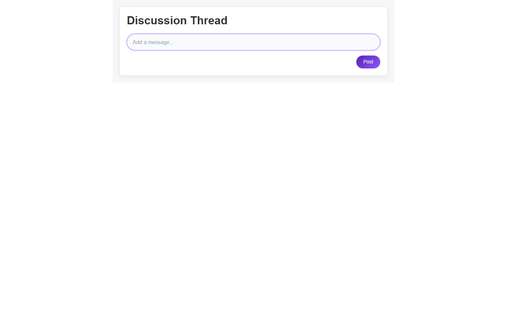

# Nested-Comments-Thread

A recursive comment system — replies nest to any depth, with add, edit, reply, delete and likes, persisted to `localStorage`.

**Live demo:** <https://nested-comment-systemm.netlify.app/>

<div align="center">


| Desktop | Mobile |
|---|---|
|  |  |

<details>
<summary>More screenshots</summary>

| Desktop | Mobile |
|---|---|
|  |  |

</details>

</div>

## What it does

A comment thread is a tree, not a list. `ThreadItem` renders one comment and then maps over its own `replies` array, so the UI is a self-recursive component. All state lives in a custom `useThreads` hook that exposes add, edit, remove and like/dislike operations and writes the whole tree to `localStorage` on every change, so a reload keeps the conversation.

## Tech stack

React 19 · Vite 6 · CSS Modules

## Features

- Unlimited reply depth via a self-recursive `ThreadItem` component
- `useThreads` hook: `addThreadItem`, `editThreadItem`, `removeThreadItem`, `rateThreadItem`
- Whole tree persisted to `localStorage` in a `useEffect` on each state change
- Inline editing with an `edited` flag, plus like/dislike counters per comment
- Initials avatar, author name and relative timestamp per item

## Run locally

```bash
git clone https://github.com/Mister2314/Nested-Comments-Thread.git
cd Nested-Comments-Thread
npm install
npm run dev
```

Limitation: `addThreadItem` and `removeThreadItem` only traverse the top level, so operations on replies nested more than one level deep don't reach their target node.
