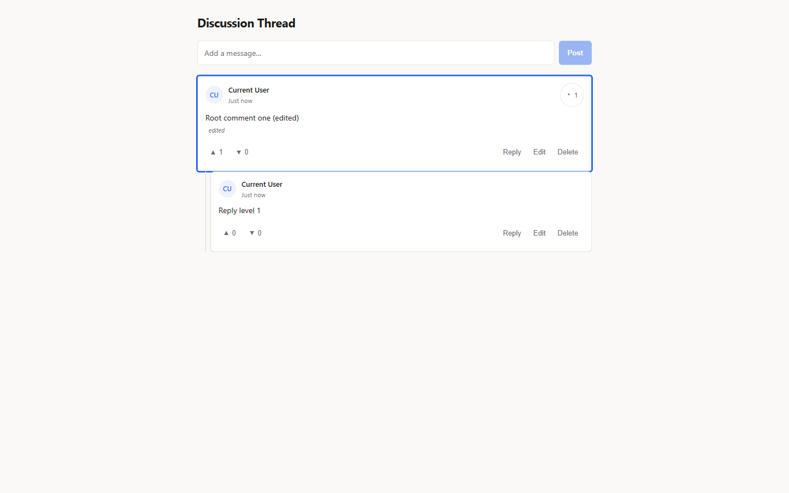
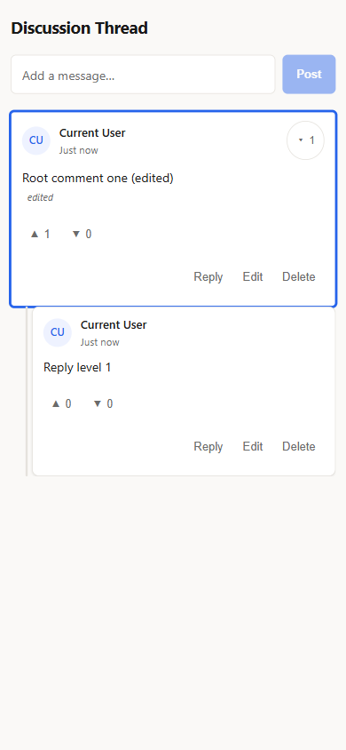

# Nested-Comments-Thread

A recursive comment system — replies nest to any depth, with add, reply, edit, delete, votes, collapsible branches and keyboard navigation. The tree persists to `localStorage`.

**Live demo:** <https://nested-comment-systemm.vercel.app/> · Legacy (Netlify): <https://nested-comment-systemm.netlify.app/>

<div align="center">

| Desktop | Mobile |
|---|---|
|  |  |

</div>

## How the tree works

A comment thread is a tree, not a list. `ThreadItem` renders one comment and then maps over its own `replies` array, so the UI is a self-recursive component. All mutations go through two immutable helpers in `utils/tree.ts` — `mapTree` and `removeTree` — which reach any node at any depth in one pass, and a single `useThread` hook exposes add, edit, remove, rate and collapse while writing state to `localStorage`.

## Tech stack

React 19 · TypeScript (strict) · Vite 6 · Motion 14 (`motion/react`) · CSS Modules

## Features

- Unlimited reply depth via a self-recursive `ThreadItem` component; depth capped visually at 4 levels with hairline depth rails
- Collapsible branches with animated reveal and per-item state persisted across reloads
- Keyboard navigation: `j`/`k` or `↑`/`↓` move through the tree in visual order, `Enter` replies, `e` edits, `Delete` removes, `c` collapses, `Esc` cancels
- ARIA tree semantics (`tree`/`treeitem`/`aria-level`/`aria-expanded`), labelled controls, roving tab index and visible focus rings
- Enter/exit micro-interactions on replies, like/dislike pop feedback, inline edit with an `edited` badge
- Mobile-first: indentation folds to a rail-only composition on small screens, 44px touch targets, safe-area insets
- Dark/light theme: follows the system by default, persists an explicit choice in `localStorage`, applies before first paint (no flash) and is designed rather than inverted (`color-scheme` aware)
- `prefers-reduced-motion` honored everywhere — the unanimated page is the complete page

## Run locally

```bash
git clone https://github.com/Mister2314/Nested-Comments-Thread.git
cd Nested-Comments-Thread
npm install
npm run dev    # dev server
npm run build  # tsc + production build
```
